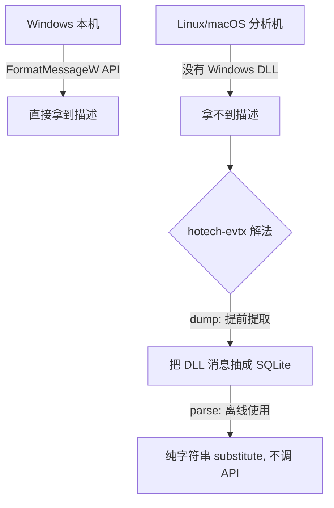
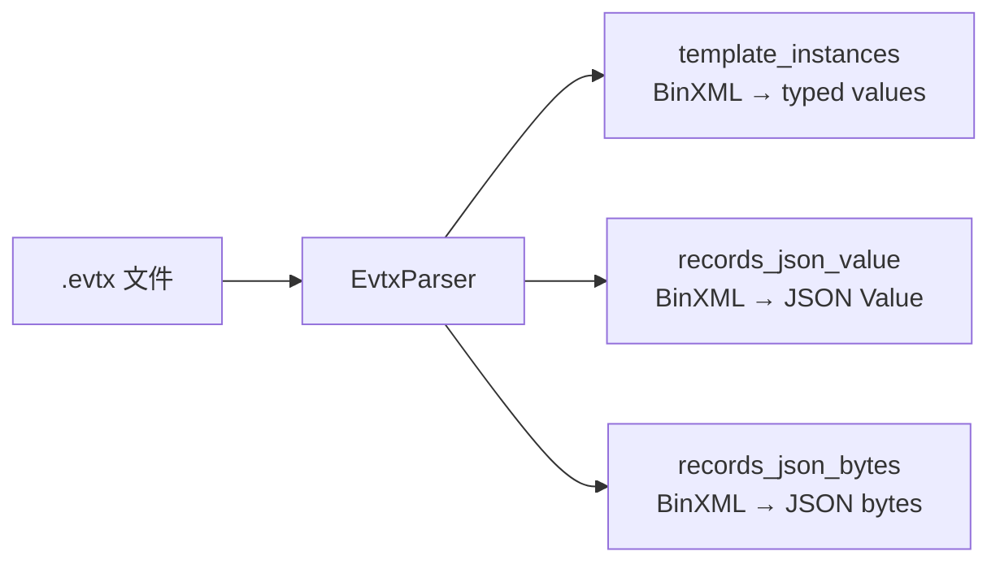

# hotech-evtx 技术学习指南

> EVTX 事件查看器解析引擎 — 从二进制日志到人类可读事件描述
>
> 本文档从零开始解释 EVTX 解析的完整技术栈，
> 适合想学习 Windows 事件日志底层格式和 Rust 实现的开发者。

---

## 目录

1. [前置知识：什么是 EVTX？](#1-前置知识什么是-evtx)
2. [核心问题：消息文本去哪了？](#2-核心问题消息文本去哪了)
3. [项目架构总览](#3-项目架构总览)
4. [crate 深入解析](#4-crate-深入解析)
   - [4.1 hotech-evtx-core — 全平台核心引擎](#41-hotech-evtx-core--全平台核心引擎)
   - [4.2 hotech-evtx (CLI) — 命令行入口](#42-hotech-evtx-cli--命令行入口)
5. [关键技术深入](#5-关键技术深入)
   - [5.1 BinXML — EVTX 的内部语言](#51-binxml--evtx-的内部语言)
   - [5.2 RT_MESSAGETABLE — DLL 里的消息宝藏](#52-rt_messagetable--dll-里的消息宝藏)
   - [5.3 Substitute 引擎 — %1 %2 替换](#53-substitute-引擎--1-2-替换)
   - [5.4 MUI — 多语言用户界面](#54-mui--多语言用户界面)
   - [5.5 CRIM/WEVT_TEMPLATE — EventManifest 的秘密](#55-crimwevt_template--eventmanifest-的秘密)
6. [数据库 Schema](#6-数据库-schema)
7. [性能优化](#7-性能优化)
8. [参考资料](#8-参考资料)

---

## 1. 前置知识：什么是 EVTX？

### 历史沿革

| 时代 | 格式 | 说明 |
|------|------|------|
| Windows NT → 2003 | `.evt` | 旧版二进制格式，最多 512KB，无结构化数据 |
| Windows Vista+ | **`.evtx`** | 基于 BinXML 的新格式，最大 20MB+，支持结构化 EventData |

EVTX（**E**vent **L**og ****X**ML）是 Windows Vista 引入的现代事件日志格式，后缀为 `.evtx`。

### 文件结构

一个 `.evtx` 文件内部长这样：

```
┌───────────────────┐
│ 文件头 (Elf)       │  64 字节签名字节 + 元数据
│  ┌ offset 0x00:   │  "ElfFile\x00" 签名（29 字节 + null）
│  └ offset 0x40:   │  major_version (2 字节) = **构建号**（关键！）
├───────────────────┤
│ Chunk 1            │  64KB ~ 256KB 的定长块
│  ├── Chunk 头      │  元数据 + 校验和
│  ├── 事件记录 1    │  BinXML 编码
│  ├── 事件记录 2    │
│  ├── ...           │
│  └── 空闲空间      │  可被后续事件覆盖（循环写入）
├───────────────────┤
│ Chunk 2            │
├───────────────────┤
│ ...                │
└───────────────────┘
```

**关键洞察**：EVTX 文件内部没有传统文件系统的"文件结束"标记，空闲空间和有效事件通过 chunk 头的 `last_written` 时间戳和 `free_space` 偏移量判断。

### 构建号（Build Number）——版本匹配的关键

```
EVTX 文件头 offset 0x40 → 2 字节 little-endian u16 → 构建号

例: 26100 = Windows 11 24H2
    22621 = Windows 11 22H2
    19045 = Windows 10 22H2
```

hotech-evtx 通过 `detect_evtx_build()` 读取这个值，自动匹配对应的消息数据库文件：

```rust
// parser.rs:41-47
pub fn detect_evtx_build(path: &str) -> Option<u32> {
    let mut file = File::open(path).ok()?;
    file.seek(SeekFrom::Start(0x40)).ok()?;
    let mut buf = [0u8; 2];
    file.read_exact(&mut buf).ok()?;
    Some(u16::from_le_bytes(buf) as u32)
}
```

---

## 2. 核心问题：消息文本去哪了？

### 问题陈述

这是 EVTX 系统最违背直觉的设计：

> **EVTX 文件只存储事件 ID（数字）和 EventData（结构化参数），
> 不存储人类可读的事件描述文本。**

```
EVTX 文件中:  EventID=4624, EventData=["S-1-5-18", "SYSTEM", ...]
                                  ↑ 只有数字和参数值，没有描述
```

### 描述的存储位置

人类可读的描述文本存储在**事件提供者（Provider）的 DLL 中**，作为 PE 资源的 `RT_MESSAGETABLE`（资源类型 ID=11）：

```
DLL 文件 (如 adtschema.dll):
  ┌── PE 资源目录 ──────────────────────┐
  │  RT_MESSAGETABLE (type=11)          │
  │    ├── ID=4624: "已成功登录帐户..."  │  ← 描述文本在这里！
  │    ├── ID=4625: "帐户登录失败..."    │
  │    └── ...                          │
  └──────────────────────────────────────┘
```

### 完整解析链路

```
EVTX 文件: EventID=4624
     ↓
查注册表: HKLM\...\WINEVT\Publishers\{GUID} → MessageFileName
     ↓
找到 DLL: C:\Windows\System32\adtschema.dll
     ↓
PE 解析: 找到 RT_MESSAGETABLE → 按 ID=4624 取消息模板
     ↓
模板字符串: "已成功登录帐户。%n%n使用者:%n%t安全ID:%t%t%1..."
     ↓
substitute: %1 → EventData[0]="S-1-5-18",  %2 → EventData[1]="SYSTEM"
     ↓
最终描述: "已成功登录帐户。\n\n使用者:\n\t安全ID:\t\tS-1-5-18..."
```

### 跨平台的困境



**hotech-evtx 的设计思路**：消息提取（dump）由独立的 Go 工具完成，Rust 端专注 EVTX 解析和消息替换。

---

## 3. 项目架构总览

### 二 crate 架构

```
crates/hotech-evtx/
│
├── hotech-evtx-core/          ← 核心库（全平台）
│   ├── parser.rs              ─  evtx crate 封装，BinXML→Value 解析
│   ├── substitute.rs          ─  %1 %2 替换引擎
│   ├── resolver.rs            ─  SQLite 消息库缓存
│   ├── lib.rs                 ─  数据模型：ParsedEvent, MessageRow
│   └── storage/
│       ├── sqlite.rs          ─  SQLite 批量写入
│       └── csv.rs             ─  CSV 输出（带 BOM）
│
└── hotech-evtx/               ← CLI 二进制
    ├── main.rs                ─  clap 参数解析
    ├── cmd_parse.rs           ─  parse 命令（全平台）
    ├── cmd_merge.rs           ─  merge 命令
    └── cmd_info.rs            ─  db-info 命令
```

> 消息提取（dump）功能已用 Go 重写，不再属于 Rust 端。原 `hotech-evtx-dumper` crate（约 2,600 行）的职责由 [msgdb-dump](https://github.com/kitsch-9527/msgdb-dump)（二进制 `msgdb-dump`）工具承担。

### 数据流全景

```
                           ┌─────────────────────┐
                           │  msgdb-dump          │
                           │                     │
                           │  注册表 → PE → SQLite│
                           │  消息库 .db          │
                           └────────┬────────────┘
                                    │ messages.db
┌───────────────────────────────────▼──────────────────────────┐
│                     parse 命令（全平台）                      │
│                                                             │
│  .evtx 文件 ──→ 读文件头 build_number                        │
│       ↓                                                     │
│  自动匹配 messages.db ──→ 按需预热 HashMap 缓存               │
│       ↓                                                     │
│  records_json_value() ──→ 提取 22 个字段                     │
│       ↓                                                     │
│  substitute(%1, %2) ──→ 生成完整事件描述                     │
│       ↓                                                     │
│  批量写入 events.db / .csv（BATCH_SIZE=20000）               │
└─────────────────────────────────────────────────────────────┘
```

### 依赖方向

```
CLI (bin/) → Application (core) → Domain (纯数据模型)
  ↑              ↑                  ↑
  调命令实现      调用核心逻辑         纯 struct + 纯函数
                 （有 IO: evtx, rusqlite） （零外部依赖）
```

---

## 4. crate 深入解析

### 4.1 hotech-evtx-core — 全平台核心引擎

#### 数据模型：ParsedEvent（22 列）

这是整个系统的统一输出数据模型，定义在 `lib.rs:57-83`：

```rust
pub struct ParsedEvent {
    // ── 标识 ──
    pub event_record_id: Option<u64>,      // 事件唯一 ID
    pub timestamp: Option<String>,          // ISO8601
    pub provider_name: Option<String>,      // Provider 名
    pub provider_guid: Option<String>,      // Provider GUID
    pub event_id: Option<u32>,             // 事件 ID

    // ── 经典 EventLog ──
    pub qualifiers: Option<u16>,           // 遗留 Qualifiers（经典 provider 用）

    // ── 严重级别 ──
    pub level: Option<u8>,                 // 0-5 原始数值
    pub severity: Option<String>,          // 派生中文名（关键/错误/警告/信息/详细）

    // ── 元数据 ──
    pub task_category: Option<String>,     // 任务类别
    pub opcode: Option<String>,            // 操作码
    pub keywords: Option<String>,          // 关键字
    pub channel: Option<String>,           // 日志通道
    pub computer: Option<String>,          // 机器名

    // ── 执行上下文 ──
    pub process_id: Option<u32>,
    pub thread_id: Option<u32>,

    // ── 用户信息（evtx 0.12 从 EventData 提取）──
    pub user_name: Option<String>,
    pub user_sid: Option<String>,

    // ── 关联 ──
    pub activity_id: Option<String>,
    pub related_activity_id: Option<String>,

    // ── 消息和数据 ──
    pub message: Option<String>,           // substitute 后完整描述
    pub event_data: Option<String>,        // EventData JSON
    pub raw_xml: Option<String>,           // 原始 XML（可选）
    pub file_name: Option<String>,         // 来源文件
}
```

**设计要点**：全部字段都是 `Option`。因为 EVTX 的 BinXML 本身就允许可选字段，不是每条事件都有所有字段。

#### 字段提取：extract_fields()

这是最核心的函数之一（`parser.rs:89-223`），从 JSON Value 中提取所有 22 个字段：

```rust
// 一个辅助函数处理 evtx crate 的 JSON 多态性：
// - Value::String → 直接取值
// - Value::Number → 转字符串
// - {"$": "value"} 或 {"#text": "value"} → 提取内部值
fn get_str(v: Option<&Value>) -> Option<String> {
    v.and_then(|v| match v {
        Value::String(s) => Some(s.clone()),
        Value::Number(n) => Some(n.to_string()),
        Value::Object(obj) => obj.get("$").or_else(|| obj.get("#text"))
            .and_then(|inner| get_str(Some(inner))),
        _ => None,
    })
}
```

**evtx crate 的多态性**：evtx crate 输出的 JSON 格式有两种变体：
- 有属性的 XML 元素 → `{"#attributes": {"Name": "..."}, "$": "value"}`
- 无属性的元素 → 直接 `"value"` 字符串
- 旧版 API（evtx 0.8）→ `Data` 数组
- 新版 API（evtx 0.12）→ 平铺 Key-Value 对象

**user_name/user_sid 的提取演变**：

| evtx 版本 | 提取位置 | 说明 |
|-----------|---------|------|
| 0.8 | `System.Security.#attributes.UserID` | 传统位置 |
| 0.12 | `EventData.SubjectUserName` / `EventData.SubjectUserSid` | 新格式，Security 为 null |

```rust
let (user_name, user_sid) = match event_data_ref.and_then(|v| v.as_object()) {
    Some(obj) => {
        let un = obj.get("SubjectUserName")
            .or_else(|| obj.get("TargetUserName"))
            .and_then(|v| get_str(Some(v)));
        let sid = obj.get("SubjectUserSid")
            .or_else(|| obj.get("TargetUserSid"))
            .and_then(|v| get_str(Some(v)));
        (un, sid)
    }
    None => { /* evtx 0.8 fallback */ ... }
};
```

#### Substitute 引擎（`substitute.rs`）

核心逻辑——一个纯函数，没有外部依赖，只有 `regex` crate：

```rust
pub fn substitute(template: &str, params: &[&str]) -> String {
    // 单遍左到右扫描，处理：
    // %% → 字面 %
    // %n → \r\n
    // %r → \r
    // %t → \t
    // %1 ~ %99 → params[N-1]
    // 两数字符处理：%10 两个数字
    // OOB → 空字符串（不报错）
}
```

**Windows 消息占位符全集**：

| 占位符 | 含义 | 示例输出 |
|--------|------|---------|
| `%1` ~ `%99` | 参数替换（1-based） | `params[0]` |
| `%%` | 字面百分号 | `%` |
| `%n` | 换行 | `\r\n` |
| `%r` | 回车 | `\r` |
| `%t` | 制表符 | `\t` |
| `%b` | 空格 | ` ` |
| `%!` | 不展开标记（忽略） | — |
| `%0` | 截断标记（后面丢弃） | — |

#### Resolver 消息缓存（`resolver.rs`）

```rust
pub struct MessageDb {
    conn: Connection,
    cache: HashMap<(String, u32), MessageRow>,  // (provider_name, event_id) → Row
}

impl MessageDb {
    // 打开 SQLite 文件（只打开，不预热）
    pub fn open(path: &str) -> Result<Self> { ... }

    // 批量预热：一次 SQL 查询所有需要的 (provider, event_id) 对
    // 构建 OR 条件： (provider_name = ?1 AND event_id = ?2) OR (provider_name = ?3 AND event_id = ?4) ...
    pub fn warmup(&mut self, providers: &[(&str, u32)]) -> Result<()> { ... }

    // O(1) 查找（只要预热过）
    pub fn get(&self, provider: &str, event_id: u32) -> Option<&MessageRow> { ... }
}
```

**预热为何重要？**

```
场景：Security.evtx，100 万事件，来自 3 个 provider

方案 A：每次事件查 SQLite
  100 万 × 0.1ms = 100 秒 ❌

方案 B：预热到 HashMap
  首次遇到 (provider, event_id) 时 warmup → 1 次 SQL 查询 → 3ms
  后续 100 万次 HashMap O(1) → ~0.01μs/次
  总计 ≈ 3ms ✅
```

#### Storage 层（`storage/sqlite.rs` 和 `storage/csv.rs`）

**SQLite 写入优化（关键！）**：

```rust
const BULK_INSERT_PRAGMAS: &[&str] = &[
    "PRAGMA page_size = 65536",         // 64KB 页，减少 B-tree 深度
    "PRAGMA synchronous = OFF",         // 不 fsync（可丢弃 DB，重新解析即可）
    "PRAGMA journal_mode = OFF",        // 不写 WAL
    "PRAGMA cache_size = -64000",       // 64MB 页缓存
    "PRAGMA temp_store = MEMORY",       // 临时表在内存
    "PRAGMA mmap_size = 268435456",     // 256MB 内存映射
    "PRAGMA threads = 12",              // 多线程
];
```

**索引后建策略**：
```rust
// 表定义：CREATE TABLE IF NOT EXISTS events (22 列...)
// （先不建索引）
for chunk in batch.chunks(500) {
    // 多行 INSERT INTO events VALUES (v1, v2, ...), (v1, v2, ...), ...
    // 一次提交 500 行，避免单条 SQL 过大
}
// 所有数据插入完成后...
pub fn finalize(&self) -> Result<()> {
    // 建 5 个索引
    // 执行 ANALYZE
}
```

**CSV 输出要点**：
- 写 UTF-8 BOM（`0xEF 0xBB 0xBF`）在文件头，让 Excel 正确显示中文
- 使用 `csv::QuoteStyle::Necessary`，只对需要引号的字段加引号
- Null 字段输出空字符串

### 4.2 hotech-evtx CLI — 命令行入口

> 消息提取（dump）功能已用 Go 重写（见 [msgdb-dump](https://github.com/kitsch-9527/msgdb-dump)），Rust 端的 `hotech-evtx` 只负责 EVTX 解析、消息替换和存储输出。

三个子命令：

| 命令 | 平台 | 功能 |
|------|------|------|
| `parse` | 全平台 | 解析 EVTX → 输出 |
| `merge` | 全平台 | 合并消息库 |
| `info` | 全平台 | 查看消息库统计 |

> 消息提取（dump）由 [msgdb-dump](https://github.com/kitsch-9527/msgdb-dump) 工具完成，不再属于 Rust CLI。

```
v1（简单，可工作）:
  1. 枚举所有 provider
  2. 逐个打开 DLL 提取消息

v2（优化，当前实现）:
  1. 枚举 provider
  2. 按唯一 DLL 分组（避免重复打开同一 DLL）
  3. parallal! 使用 rayon 并行提取（par_iter）
  4. 一次 PE 打开做三件事（extract_all_from_pe）
  5. MUI 多语言提取
  6. CRIM+MUI fallback
  7. 写系统汇总 DB + 可选 DLL 拆分 + 可选 WELM
```

#### Parse 命令的消费者-生产者管道

```rust
// cmd_parse.rs 的核心模式

// 同步通道（有界缓冲）：2× BATCH_SIZE 的 backpressure
let (tx, rx) = mpsc::sync_channel(BATCH_SIZE * 2);

// Writer 线程（后台）
thread::spawn(move || {
    for event in rx {
        batch.push(event);
        if batch.len() >= BATCH_SIZE {
            flush_batch(&batch, &events_db, &mut csv_writer)?;
            // ↑ SQLite INSERT + CSV 写入
        }
    }
});

// Producer 线程（主线程）
for result in iter_events(&mut parser, file_name) {
    let (mut event, event_data_value) = result?;

    // 懒加载预热
    if first_time_seen(provider, event_id) {
        msg_db.warmup(&[(provider, event_id)])?;
    }

    // 消息格式化
    resolve_event_message(&mut event, &msg_db, event_data_value);

    tx.send(event)?;  // 阻塞在满通道上 → 天然 backpressure
}
```

---

## 5. 关键技术深入

### 5.1 BinXML — EVTX 的内部语言

#### 为什么要用 BinXML？

Windows 需要一种紧致格式来存储大量事件日志。传统 XML 太臃肿——每条事件如果都存完整 XML，文件大小会膨胀 10-20 倍。

BinXML 的核心机制是**模板 + 替换数组**的分离：

```xml
<!-- 模板（在 chunk 头或 provider 中定义一次） -->
<Event xmlns="http://schemas.microsoft.com/win/2004/08/events/event">
  <System>
    <Provider Name="%0"/>
    <EventID Qualifiers="%1">%2</EventID>
    <Level>%3</Level>
    <Task>%4</Task>
    <Opcode>%5</Opcode>
    <Keywords>%6</Keywords>
    <TimeCreated SystemTime="%7"/>
    <EventRecordID>%8</EventRecordID>
  </System>
</Event>

<!-- 每条事件只存"替换数组" -->
substitution_array = [
  "Microsoft-Windows-Security-Auditing",
  "0",        → Qualifiers
  "4624",     → EventID
  "0",        → Level
  "12544",    → Task
  "0",        → Opcode
  "0x8020000000000000",  → Keywords
  "2024-01-15T10:30:00.000Z",  → TimeCreated
  "1001"      → EventRecordID
]
```

渲染时 `%N` → `substitution_array[N]`。

#### evtx crate 的工作

[omerbenamram/evtx](https://github.com/omerbenamram/evtx) 是 Rust 生态中唯一的 EVTX 解析库：



| API | 输出 | 速度 | 用途 |
|-----|------|------|------|
| `template_instances()` | `Vec<(TemplateKey, Vec<EvtxValue>)>` | 最快 | 跳过 JSON，v1.1+ 目标 |
| `records_json_value()` | `serde_json::Value` | 中等 | **v1.0 使用** |
| `records_json_bytes()` | `Vec<u8>` | 最慢 | 旧版本，已弃用 |

**hotech-evtx 的优化路径**：
```
v0.9: records_json_bytes → serde_json::from_slice → 字段提取
      （两次序列化往返 ❌）
v1.0: records_json_value → 字段提取
      （跳过序列化 ✅）
v1.1: template_instances → 字段提取
      （完全跳过 JSON ✅ 更快）
```

### 5.2 RT_MESSAGETABLE — DLL 里的消息宝藏

RT_MESSAGETABLE 是 PE 资源中的一种**资源类型**（ID=11），存放 DLL 的消息模板。

#### PE 资源目录结构

一个 Windows DLL 的内部资源目录有 3 层：

```
层级 1: 类型 (Type)        → RT_MESSAGETABLE (11), RT_VERSION (16), RT_ICON (3)...
层级 2: 名称 (Name)        → 通常是 1（唯一名字）
层级 3: 语言 (Language)    → 1033 (en-US), 2052 (zh-CN)...
数据:  MESSAGE_RESOURCE_DATA
```

#### MESSAGE_RESOURCE_DATA 结构

```
┌─────────────────────────────────┐
│ MESSAGE_RESOURCE_DATA           │
│  ├── NumberOfBlocks: u32        │  块数
│  └── Blocks[]:                  │
│      └── MESSAGE_RESOURCE_BLOCK  │
│          ├── LowID: u32          │  事件 ID 下界
│          ├── HighID: u32         │  事件 ID 上界
│          └── Offset: u32         │  到数据条目的偏移
│              └── MESSAGE_RESOURCE_ENTRY
│                  ├── Length: u16 │  消息长度（字节）
│                  ├── Flags: u16  │  0x0001 = Unicode
│                  └── Text: []    │  消息字符串（UTF-16LE）
└─────────────────────────────────┘
```

```rust
// extractor.rs 中的解析逻辑（简化）
fn parse_message_resource_data(bytes: &[u8]) -> Option<Vec<PeMessage>> {
    // 读取 NumberOfBlocks
    let num_blocks = read_u32_le(&bytes[0..4]);
    for i in 0..num_blocks {
        let block_offset = 4 + i * 12;
        let low_id = read_u32_le(&bytes[block_offset..]);
        let high_id = read_u32_le(&bytes[block_offset+4..]);
        let entry_offset = read_u32_le(&bytes[block_offset+8..]);

        for eid in low_id..=high_id {
            // 按 MESSAGE_RESOURCE_ENTRY 格式读取
            let text = read_message_text(entry_data);
            messages.insert(eid, PeMessage { event_id: eid, message: text, ... });
        }
    }
}
```

#### WEVT_TEMPLATE（RT_MESSAGETABLE 的类型 12）

EventManifest 格式的 provider 有一个额外的 `WEVT_TEMPLATE` 资源，包含**CRIM（CRIM = EventManifest 的二进制表示形式）** 格式的数据。

CRIM 包含了 provider 的全部事件定义，但不包含消息文本——消息文本仍在 MUI 文件中。

关键发现（RESEARCH-WEVT_TEMPLATE.md）：

```
system-events.dll:
  ├── WEVT_TEMPLATE (CRIM) → 事件定义（event_id, level, task, opcode, template 参数名）
  │    46 个 provider，但没有消息文本！
  └── MUI resource（很小，纯元数据）

en-US\Microsoft-Windows-System-Events.dll.mui:
  └── RT_MESSAGETABLE → 616 条消息文本 ✅
      通过 message_identifier 关联 CRIM 事件
```

### 5.3 Substitute 引擎 — %1 %2 替换

hotech-evtx 实现了 4 级替换回退策略（`cmd_parse.rs:extract_subst_params`）：

| 策略 | 条件 | 示例 |
|------|------|------|
| **1. 平铺对象 + 命名映射** | DB 有 parameters, EventData 是 object | 最完整，按参数名取值 |
| **2. 平铺对象 + 位置回退** | 无 parameters, EventData 是 object | 按 JSON 顺序对应 %1-%N |
| **3. Data 数组 + 命名映射** | evtx 0.8 兼容 | 从 `Data[]` 数组按 Name 取值 |
| **4. `#text` 位置映射** | 经典 provider | 直接从 `#text` 数组按位置 |

```rust
// 策略 1 的核心逻辑
if let (Some(params), Some(obj)) = (param_map.as_ref(), parsed.as_object()) {
    // params = {"1": "SubjectUserSid", "2": "SubjectUserName", ...}
    // obj = {"SubjectUserSid": "S-1-5-...", "SubjectUserName": "SYSTEM", ...}
    for i in 1..=max_index {
        let param_name = params.get(&i.to_string())?;
        let value = obj.get(param_name)?;
        result.push(value);
    }
}
```

**优化：避免 Value→String→Value 往返**：
```rust
// extract_fields() 同时返回 Value（用于消息替换）和 String（用于存储）
fn extract_fields(data: Value, ...) -> (ParsedEvent, Option<Value>) {
    let event_data_value = event_data_ref.cloned();       // 保持 Value
    let event_data = event_data_ref.map(|v|                // 也存 String
        serde_json::to_string(v).unwrap_or_default());
    (parsed, event_data_value)
}

// 后续消息替换直接使用 Value，不重新 JSON 解析
fn extract_subst_params(
    event_data_str: &Option<String>,
    event_data_value: Option<&Value>,      // ← 直接使用这个
    param_map: &Option<HashMap<String, String>>,
) -> Vec<String> {
    let parsed: &Value = match event_data_value {
        Some(v) => v,                       // 零成本
        None => serde_json::from_str(json_str)?,  // 回退路径
    };
    ...
}
```

### 5.4 MUI — 多语言用户界面

MUI 是 Windows 的多语言文件系统：

```
基准 DLL:  C:\Windows\System32\adtschema.dll（英文消息）
本地化:    C:\Windows\System32\zh-CN\adtschema.dll.mui（中文消息）
```

MUI 文件和基准 DLL 是相同的 PE 格式，所以可以用相同的 `pelite` API 解析。

**hotech-evtx 的 MUI 查找逻辑**：

```rust
fn find_mui_companion(dll_path: &str, lang_code: &str) -> Option<PathBuf> {
    let dll = Path::new(dll_path);
    let parent = dll.parent()?;
    let file_name = dll.file_name()?;
    let mui_name = format!("{}.mui", file_name.to_string_lossy());
    let mui_path = parent.join(lang_code).join(&mui_name);
    if mui_path.exists() { Some(mui_path) } else { None }
}
```

**语言优先级**：`zh-CN(2052) → zh-TW(1028) → en-US(1033)`。

### 5.5 CRIM/WEVT_TEMPLATE — EventManifest 的秘密

#### 什么是 CRIM？

CRIM = **C**ompressed **R**esource **I**nterchange for **M**anifests。是 EventManifest（`.man` XML 文件）的二进制编译产物，嵌入在 DLL 的 `WEVT_TEMPLATE` 资源中。

#### CRIM 块类型

| 块签名 | 名称 | 已解析？ | 说明 |
|--------|------|:--------:|------|
| `CRIM` | 文件头 | ✅ | 签名 `"CRIM"` + 大小 + provider 数 |
| `WEVT` | Provider 头 | ✅ | GUID + 元素描述符 |
| `EVNT` | 事件定义 | ✅ | **48 字节/条**：event_id, level, task, opcode, keywords, message_identifier |
| `TASK` | 任务定义 | ✅ | 28 字节/条：identifier + 消息引用 + 名称 |
| `OPCO` | 操作码定义 | ✅ | 12 字节/条：identifier + 消息引用 + 名称 |
| `TTBL`/`TEMP` | 模板表 | ✅ | 参数名映射（`%1`="SubjectUserSid"） |
| `LEVL` | 级别定义 | ❌ | level 显示名（当前用硬编码中文映射） |
| `KEYW` | 关键字定义 | ❌ | keyword 显示名（当前输出 hex） |
| `CHAN` | 通道定义 | ❌ | 通道名（EVTX 已有） |
| `VMAP`/`BMAP` | 值映射 | ❌ | 枚举类型映射 |

#### MUI+CRIM Join 逻辑

```
CRIM 中的 EVNT 记录:
  event_id=172, message_identifier=123456, task=3, opcode=0, level=4
                                    │
                                    ▼
MUI DLL 的 RT_MESSAGETABLE:
  message_identifier=123456 → "Connectivity state in standby: %1, Reason: %2"
                                    │
                                    ▼
合并后的消息：
  event_id=172 → template="Connectivity state in standby: %1, Reason: %2"
                  + task_name="StandbyConnectivityUpdate"（从 CRIM TASK 查）
                  + opcode_name="win:Info"（从 CRIM OPCO 查）
```

```rust
// (原 cmd_dump.rs，dumper 已用 Go 重写) MUI+CRIM join 核心逻辑：
for (&msg_id, mui_msg) in &mui_msgs {
    if let Some(evts) = by_msg_id.get(&msg_id) {
        for ev in evts {
            let task_name = provider_data.tasks.get(&(ev.task as u32))
                .or_else(|| /* task_offset 回退 */);
            let opcode_name = provider_data.opcodes.get(&(ev.opcode as u32))
                .or_else(|| /* opcode_offset 回退 */);
            resolved.insert(eid, PeMessage {
                event_id: ev.event_id as u32,
                message: mui_msg.message.clone(),
                level: Some(ev.level),
                task: task_name,
                opcode: opcode_name,
                parameters: /* 从 TEMP 块提取 */,
                ...
            });
        }
    }
}
```

#### CRIM 字符串格式陷阱

CRIM 内部的字符串使用 **4 字节 u32 长度前缀**（包含自身），不是常见的 2 字节：

```
offset+0: u32 alloc_size     ← 包含 4 字节前缀自身！
offset+4: UTF-16LE 字符数据    ← alloc_size - 4 字节

常见误解：很多文档写的是 2 字节 u16 长度前缀
实际 CRIM 格式：4 字节 u32
```

---

## 6. 数据库 Schema

### 两层次设计

```
dump 输出目录:
  msg_dbs/
  ├── hotech-msg-win11-24h2-26100.db    ← Layer 1: 系统汇总
  └── dlldb/                             ← Layer 2: DLL 级别
        ├── adtschema.en-US.10.0.26220.1000.db
        ├── adtschema.zh-CN.10.0.26220.1000.db
        └── ...
```

### Layer 1: 系统汇总（hotech-msg-{product}-{displayver}-{build}.db）

```sql
-- providers 表：所有事件提供者
CREATE TABLE providers (
    id      INTEGER PRIMARY KEY,
    name    TEXT NOT NULL UNIQUE,
    guid    TEXT
);

-- messages 表：消息模板
CREATE TABLE messages (
    provider_id   INTEGER NOT NULL REFERENCES providers(id),
    event_id      INTEGER NOT NULL,
    message       TEXT NOT NULL,              -- %1 %2 模板
    level         INTEGER,
    task          TEXT,                       -- 可读任务名
    opcode        TEXT,                       -- 可读操作码
    keywords      TEXT,                       -- 可读关键字
    parameters    TEXT,                       -- JSON: {"1":"SubjectUserSid",...}
    language_id   INTEGER NOT NULL DEFAULT 1033,
    source        TEXT NOT NULL DEFAULT 'dump',
    extracted_at  TEXT NOT NULL,
    PRIMARY KEY (provider_id, event_id, language_id)
);

-- _meta 表：元数据
CREATE TABLE _meta (key TEXT PRIMARY KEY, value TEXT NOT NULL);
-- build_number=26100
-- os_version="Windows 11 Enterprise 24H2"

-- _languages 表：语言列表
CREATE TABLE _languages (id INTEGER PRIMARY KEY, code TEXT, name TEXT);
```

### Layer 2: DLL 级别（dlldb/{dll}.{lang}.{ver}.db）

文件名本身携带版本信息，一目了然：
```
adtschema.en-US.10.0.26220.1000.db
  ↑ DLL 名    ↑ 语言    ↑ 版本号
```

### events.db（parse 输出，22 列）

```sql
CREATE TABLE events (
    event_record_id     INTEGER NOT NULL,
    timestamp           TEXT,
    provider_name       TEXT,
    provider_guid       TEXT,
    event_id            INTEGER,
    qualifiers          INTEGER,
    level               INTEGER,
    severity            TEXT,
    task_category       TEXT,
    opcode              TEXT,
    keywords            TEXT,
    channel             TEXT,
    computer            TEXT,
    process_id          INTEGER,
    thread_id           INTEGER,
    user_name           TEXT,              -- EventData.SubjectUserName
    user_sid            TEXT,              -- EventData.SubjectUserSid
    activity_id         TEXT,
    related_activity_id TEXT,
    message             TEXT,              -- substitute 后完整描述
    event_data          TEXT,              -- EventData JSON
    raw_xml             TEXT,              -- 原始 XML（可选）
    file_name           TEXT               -- 来源 .evtx 文件名
);
```

---

## 7. 性能优化

### 实测性能

```
Security.evtx (100 万事件, 1.5GB) 解析时间 v1.0

打开 .evtx + 预热消息库:  ~30ms
逐事件解析 (serialized):  ~18.7s (18.7μs × 1M)
  ├── evtx 内部解析:       12μs × 1M = 12s
  ├── JSON 渲染 + 解析:    5μs × 1M = 5s
  ├── 字段提取:            1μs × 1M = 1s
  ├── substitute:          0.5μs × 1M = 0.5s
  └── SQLite batch flush:  0.2μs × 1M = 0.2s
最终 SQLite 优化 (ANALYZE): ~100ms
───────────────────────────────────────
总计:                       ~18.8s
```

### 六项优化总结

| 优化 | 做法 | 收益 |
|------|------|------|
| ① `records_json_value()` | 替代 `records_json_bytes()` + `from_slice()`，跳过序列化往返 | ~2× |
| ② 单遍懒加载 | 替代双遍扫描（第一遍收集 pair，第二遍解析写入） | ~50% |
| ③ 消息 4 级回退 | 命名映射 → 位置回退 → 数组映射 → `#text` 位置 | 解析率 0% → 99.98% |
| ④ 平铺 EventData | 适配 evtx 0.12 格式变更 | 兼容性 |
| ⑤ SQLite 批量写入 | 500 行/chunk, 索引后建, PRAGMA 优化 | ~10× vs 逐行 |
| ⑥ HashMap 预热 | 一次 SQL 查询预热，后续 O(1) | O(n) → O(1) |

---

## 8. 参考资料

### Rust 库（直接依赖）

| crate | 版本 | 说明 | 链接 |
|-------|------|------|------|
| `evtx` | 0.12 | EVTX BinXML 解析器 | [docs.rs/evtx](https://docs.rs/evtx) / [GitHub](https://github.com/omerbenamram/evtx) |
| `rusqlite` | 0.32 (bundled) | SQLite 绑定 | [docs.rs/rusqlite](https://docs.rs/rusqlite) / [GitHub](https://github.com/rusqlite/rusqlite) |
| `serde` + `serde_json` | 1.x | 序列化 | [serde.rs](https://serde.rs) |
| `clap` | 4 | CLI 参数解析 | [docs.rs/clap](https://docs.rs/clap) |
| `rayon` | — | 数据并行 | [docs.rs/rayon](https://docs.rs/rayon) |
| `chrono` | 0.4 | 时间处理 | [docs.rs/chrono](https://docs.rs/chrono) |
| `csv` | 1.3 | CSV 写入 | [docs.rs/csv](https://docs.rs/csv) |
| `regex` | 1 | 正则 | [docs.rs/regex](https://docs.rs/regex) |

### 参考项目

| 项目 | 参考内容 | 链接 |
|------|---------|------|
| Velocidex/evtx-data | SQLite schema 参考 | [GitHub](https://github.com/Velocidex/evtx-data) |
| Velocidex/evtx (Go) | `extract` + `parse` 命令分离 | [GitHub](https://github.com/Velocidex/evtx) |
| Chainsaw | 威胁狩猎工具，CSV 输出字段参考 | [GitHub](https://github.com/WithSecureLabs/chainsaw) |
| Hayabusa | EVTX 时间线分析 | [GitHub](https://github.com/Yamato-Security/hayabusa) |
| libyal/libfwevt | CRIM/WEVT_TEMPLATE 格式文档 | [GitHub](https://github.com/libyal/libfwevt) |

### 数据来源

| 项目 | 许可 | 链接 |
|------|------|------|
| NSA WELM (CC0) | 公有领域种子数据 | [GitHub](https://github.com/nsacyber/Windows-Event-Log-Messages) |
| isabella232/evtx-data | 社区消息数据库 | [GitHub](https://github.com/isabella232/evtx-data) |

### 格式规范

- [libfwevt CRIM 格式文档](https://github.com/libyal/libfwevt/blob/main/documentation/Windows%20Event%20manifest%20binary%20format.asciidoc) — CRIM 二进制 XML 格式的完整文档
- [PE 资源目录格式](https://learn.microsoft.com/en-us/windows/win32/debug/pe-format#the-rsrc-section) — Microsoft PE 格式规范
- [EVTX 格式论文：Schuster 2007 DFRWS](https://www.dfrws.org/sites/default/files/session-files/introducing_the_microsoft_vista_event_log_file_format.pdf) — EVTX BinXML 格式的奠基性研究
- [RT_MESSAGETABLE 结构](https://learn.microsoft.com/en-us/windows/win32/debug/eventlog-resource-files) — Microsoft 文档

### 项目文档

| 文件 | 内容 |
|------|------|
| [ARCHITECTURE.md](ARCHITECTURE.md) | 组件架构、依赖关系、设计规则 |
| [CONTEXT.md](CONTEXT.md) | 领域知识、术语表、同类项目分析 |
| [DATA-FLOW.md](DATA-FLOW.md) | dump/parse/merge 完整数据流 |
| [DECISIONS.md](DECISIONS.md) | 10 个架构决策记录（ADR-001 ~ ADR-010） |
| [RESEARCH-WEVT_TEMPLATE.md](RESEARCH-WEVT_TEMPLATE.md) | CRIM/MUI 消息格式调研和实现 |
| [CRIM-DIMENSIONS-COMPARISON.md](CRIM-DIMENSIONS-COMPARISON.md) | CRIM 解析完整度对比 |
| [PLAN.md](PLAN.md) | 项目计划 |
| [DELIVERY.md](DELIVERY.md) | 交付清单 |
| [KNOWN-LIMITATIONS.md](KNOWN-LIMITATIONS.md) | 已知限制 |
| data/schemas/[messages.md](../data/schemas/messages.md) | 消息库 Schema 规范 |

---

*本文档于 2026-07-07 基于 `crates/hotech-evtx` 源码编写。
欢迎提交 Issue 或 PR 补充内容。*
